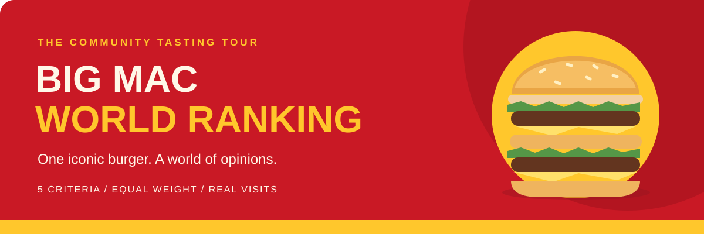

<p align="center">
  
</p>

<h1 align="center">🍔 Big Mac World Ranking</h1>

<p align="center">
  A community tasting tour of Big Macs around the world.<br>
  Real visits. Shared criteria. Every review counts equally.
</p>

<p align="center">
  <a href="https://github.com/nardocesar/big-mac-world-ranking/issues/new?template=review.yml">Submit a review</a> ·
  <a href="#-the-scoring-menu">Scoring criteria</a> ·
  <a href="RESTAURANTS.md">Best restaurants</a> ·
  <a href="CONTRIBUTORS.md">Top contributors</a>
</p>

---

## 🍟 Fresh out of the kitchen

This project started with a travel habit: visit McDonald's, order a Big Mac, and compare it with previous ones. Now anyone can contribute to an open, collective ranking. The project's creator gets exactly the same voting weight as everyone else.

| Ready to serve | Current status |
| --- | --- |
| 📋 Shared review criteria | Five criteria, scored from 1 to 5 |
| 📍 Restaurant identification | A Google Maps link to the exact location |
| 🤝 Community contributions | [Fill out a review form](https://github.com/nardocesar/big-mac-world-ranking/issues/new?template=review.yml); automation creates the PR |
| 🍔 Review collection | Accepted reviews are individual Markdown files in [`reviews/`](reviews/) |
| 🏆 Restaurant ranking | [Best restaurants](RESTAURANTS.md), rebuilt automatically after accepted changes |
| 🍟 Contributor ranking | [Top contributors](CONTRIBUTORS.md), with scored and memory counts |

You only need a GitHub account to contribute. Submit a form, wait for maintainer review, and your accepted visit becomes part of the rankings. There is no separate website or database. Maintainers: see the [automation setup guide](docs/automation.md) before activating the workflow.

## 🍔 The order: original Big Mac only

> **The standard local recipe. No extras. No ingredients removed. No special editions.**
>
> This applies to every contribution, including reviews from memory. Differences between standard local recipes are part of the experience.

Each review covers **one Big Mac eaten at one restaurant on one date**. One visit to a single location does not represent an entire country.

Dine-in, takeout, and delivery are all welcome. Label the order type: transport and time before eating can affect the experience and should stay visible in comparisons.

## 📋 The scoring menu

Give each criterion a **whole-number score from 1 to 5**, with a brief explanation of what you observed.

| | Criterion | What to look for |
| --- | --- | --- |
| 👅 | **Flavor and balance** | Do the beef, sauce, cheese, and vegetables work well together? Is there too much or too little of any ingredient? |
| 🥬 | **Texture** | Is the bun soft, the lettuce crisp, and the beef neither dry nor rubbery? |
| 🌡️ | **Temperature** | Did the burger arrive at the temperature you would expect for eating? |
| ✨ | **Perceived freshness** | Do the bun and vegetables seem fresh? Does the burger seem to have sat ready for a while? Describe your perception without assuming kitchen conditions. |
| 🍔 | **Assembly** | Are the ingredients evenly distributed and well proportioned? Is the burger easy to eat? |

### Pick your score

| Score | Meaning | Reference |
| --- | --- | --- |
| **1 / 5** | Very poor | Major problems that seriously hurt the experience. |
| **2 / 5** | Below expectations | Noticeable problems that hurt the experience. |
| **3 / 5** | Good / standard | Meets expectations for a Big Mac. |
| **4 / 5** | Very good | Stands out positively on this criterion. |
| **5 / 5** | Exceptional | A standout experience supported by a concrete explanation. |

**Price, service, and atmosphere stay off the scorecard.** You can describe them separately as context.

## 🧮 From one bite to a world ranking

All five criteria have equal weight:

```text
                Flavor + Texture + Temperature + Freshness + Assembly
Final score  =  ──────────────────────────────────────────────────────
                                          5
```

For example, **4 + 3 + 4 + 3 + 5 = 19 → 3.80 / 5**.

The [restaurant ranking](RESTAURANTS.md) uses the average final score of accepted scored reviews for each location. Every review has equal weight. The calculation uses unrounded values, displays two decimal places, and treats identical exact averages as ties. City and country rankings are not generated.

Every published average must show the **number of reviews, number of unique contributors, and date range of visits**. A single visit is an initial sample, not a verdict on a whole country. Reviews from memory do not enter these averages.

## 🤝 How to contribute

### Eat → Fill out a form → We take it from there

1. **Try the original.** Order a standard local Big Mac without extras, removed ingredients, or special editions.
2. **Find your restaurant.** Open its specific Google Maps place listing and select **Share → Copy link**. Use the individual restaurant, not a general search or city map.
3. **[Submit a review](https://github.com/nardocesar/big-mac-world-ranking/issues/new?template=review.yml).** Fill out the form with your visit, scores, and comments. No download, fork, Markdown editing, or manual pull request is needed.
4. **Follow the review.** The automation replies on your issue with a PR containing your formatted review file. If details are missing, it tells you what to fix. Edit the issue to update a pending submission; keep the generated field headings intact.
5. **Wait for acceptance.** A maintainer reviews the PR and merges it. The rankings then update automatically. Closing a PR without merging does not accept the review.

```text
🍔 Your visit → 📝 Review form → 🤖 Automatic PR → ✅ Maintainer merge → 🏆 Rankings
```

### What goes on the receipt?

| Required for a scored review | Optional extras for your story |
| --- | --- |
| Google Maps link to the exact restaurant | Photo |
| Visit date in `YYYY-MM-DD` format | Price and local currency |
| Dine-in, takeout, or delivery | Whether the price is for the burger or a meal |
| Confirmation of the original, unmodified recipe | Approximate time between receiving the order and eating |
| Five scores, each with an explanation | Comments on service and atmosphere |
| An overall comment (the final score is calculated for you) | |

Your GitHub account on the original issue identifies you as the reviewer, even though the bot opens the PR. The Google Maps listing identifies the restaurant. The form does not ask you to repeat your username, country, city, or restaurant address.

Use your own photos or photos you have permission to share, and avoid exposing other people.

## 🏆 Explore the rankings

| Ranking | How it works |
| --- | --- |
| [🍔 Best McDonald's restaurants](RESTAURANTS.md) | Average Big Mac score per location, with review count, distinct contributors, visit dates, and links to reviews |
| [🍟 Top contributors](CONTRIBUTORS.md) | Total accepted reviews per person, with scored reviews and memory reviews shown separately |

Each accepted visit has a permanent Markdown record in [`reviews/`](reviews/). Corrections replace that record; they do not add another visit or contributor credit. Rankings are rebuilt from those files after merges, rather than from later edits to issue descriptions.

Maintainers check restaurant grouping before acceptance: two different Google Maps links can point to the same location. A restaurant with a single review is still an initial sample.

## 🧾 House rules

- **Your burger, your review.** Review only what you personally ate; do not submit scores on someone else's behalf.
- **One person, one visit, one review.** Do not duplicate reviews or split the same burger into multiple contributions.
- **Come back for seconds.** Repeat visits to the same restaurant are welcome; record each visit's date.
- **Explain the score.** Base it on your observed experience. Disagreement is not a reason to reject a review.
- **Keep it respectful.** Focus comments on the experience.
- **Correct the record.** To fix an accepted review, use the same form, select **Correction**, give the original review issue number, and select the replacement review type. Include the full updated review and explain the change in your comments. Only the original reviewer or a maintainer can submit a correction; it still requires review and merge. Editing an already accepted issue does not change the record.

### 🕰️ A Big Mac you remember

Older stories are welcome, even without an exact date or enough detail to assign scores. Select **Review from memory** in the form, share only what you remember, and make uncertainties explicit. The original-recipe rule still applies.

If you cannot identify the exact restaurant, leave the Google Maps link blank and explain the uncertainty. Leave scores blank if you cannot recall enough detail. Do not invent dates or scores to complete the form.

These accounts count toward your contributor total, in a separate **From memory** column, but **never count toward restaurant ranking averages**.

---

<p align="center"><strong>One iconic burger. A world of opinions.</strong><br>Built by people who always find time for a Big Mac.<br /><sup><sub>This is an independent community project with no affiliation with McDonald's. Big Mac and McDonald's are trademarks of their respective owners.</sub></sup></p>
